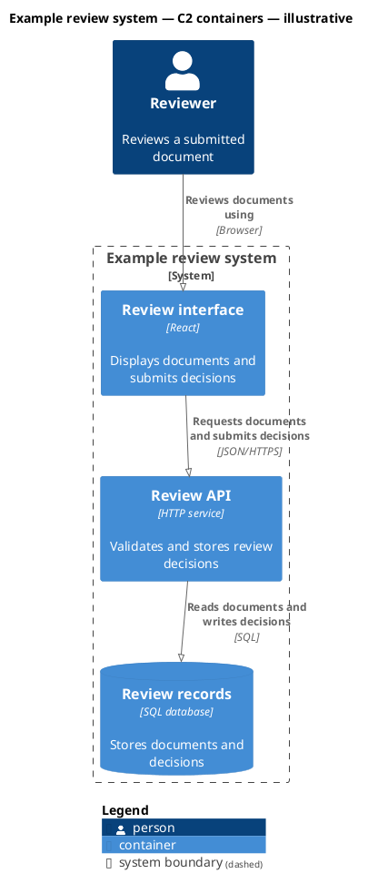

# Agent handoffs

After developing a feature, create a new handoff at `docs/handoffs/<new-feature-slug>/index.mdx` at the repository root. Keep all related screenshots, C4 sources, and evidence in that handoff's `assets/` folder; never share asset folders between handoffs. While a feature is in progress, update its own handoff. Once it is complete, do not edit it to document another feature; create a new handoff with a new slug. A completed handoff is an immutable historical record: preserve its title, summary, body, evidence, screenshots, worktree, branch, commit and `updatedAt`. The only permitted change is adding a newly required frontmatter field during a repository-wide metadata migration. Record observed facts and explicit unknowns; never include secrets.

Run the independent viewer with `bun run dev:handoffs` and open <http://127.0.0.1:3002/>. Documents open at `/#/<feature-slug>`; built previews need rebuilding after changes.

Use this small starting template. Record actual worktree, branch, HEAD, coding agent and agent session, and UTC update time; these fields appear in the document header. Status: in progress / blocked / ready for review / complete. Use `opencode`, `codex`, `claude` or the actual agent name, and paste the agent's session identifier. Use `Not recorded` only for historical documents whose session was not captured.

```mdx
import desktop from './assets/desktop.png';
import mobile from './assets/mobile.png';

export const metadata = {
  title: 'Feature name',
  status: 'in progress',
  agent: 'opencode',
  session: 'ses_...',
  worktree: '/absolute/path/to/session-worktree',
  branch: 'session/feature-name',
  commit: 'Recorded Git HEAD',
  updatedAt: 'YYYY-MM-DDTHH:mm:ssZ',
  summary: 'One sentence describing the technical change and its reason.',
};

## Goal

What success looks like and what is in scope.

## Technical changes

Baseline: record the base commit and the compared session commit. Explain the implementation delta, data flow, contracts, dependencies, configuration and migration impact where relevant. Add focused prose when the table alone cannot explain a decision.

| Area                   | Before                                 | After                | Why                 | Code                                 |
| ---------------------- | -------------------------------------- | -------------------- | ------------------- | ------------------------------------ |
| Changed responsibility | Previous behavior or absent capability | Implemented behavior | Reason and tradeoff | Relevant repository paths or symbols |

## Architecture changes

Introduce the product and relevant terms briefly. Explain how the technical changes above affect boundaries, responsibilities and interactions. Account for every C4 level; show diagrams only where useful.

| Level | Change                                                                             | Evidence                            |
| ----- | ---------------------------------------------------------------------------------- | ----------------------------------- |
| C1    | Added/changed/removed systems or people, or Unchanged with a reason                | Diagram or implementation reference |
| C2    | Added/changed/removed applications or stores, or Unchanged with a reason           | Diagram or implementation reference |
| C3    | Added/changed/removed responsibilities or interactions, or Unchanged with a reason | Diagram or implementation reference |

Embed the relevant change-annotated diagrams here. Each view must show its changes in the diagram itself and have a short Change explanation that links back to the technical changes. Label unchanged context explicitly in the legend.

## Verification

| Check                 | Result  | Evidence                                                                                        |
| --------------------- | ------- | ----------------------------------------------------------------------------------------------- |
| Focused regression    | NOT RUN | Exact command, observed result/counts and evidence path when run; otherwise explain why not run |
| Repository build      | NOT RUN | `bun run build`; record exit status when run                                                    |
| Desktop/mobile review | NOT RUN | Viewports, screenshot paths, observed behavior and limitations                                  |

## Appearance

<AppearanceGallery
  images={[
    {
      src: desktop,
      title: 'Desktop',
      alt: 'Desktop feature view',
      description:
        'Describe exactly what the reviewer should check in this image.',
    },
    {
      src: mobile,
      title: 'Mobile',
      alt: 'Mobile feature view',
      description:
        'Describe the mobile layout or behavior the reviewer should check.',
    },
  ]}
/>

## Next steps

Next concrete action, remaining work, blockers, and questions. Write "None" when complete.
```

## Required handoff structure

New handoffs describe what changed relative to the recorded base commit. Use the template's required sections in order: Goal, Technical changes, Architecture changes, Verification, Next steps. Appearance is optional after Verification. Keep the summary focused on the change, and remove the former Current state section. The Technical changes and Architecture changes tables are required; expand them with focused implementation explanations and diagrams as needed.

All verification outcomes belong in the Verification table, including failures, skipped checks, commands, evidence and limitations. Do not replace it with bullet lists or PASS paragraphs. PASS means an observed successful check; FAIL means an observed failure; NOT RUN means no result is available. Preserve useful evidence even when a check fails.

`bun run --cwd apps/handoffs docs:check` parses MDX and rejects missing/out-of-order sections, missing table columns, empty evidence, unsupported results and new diagrams without change annotations or an explicit unchanged reason. It runs in the handoff build and typecheck, including the normal repository precommit hook. Six historical slugs are frozen exceptions in `check-handoffs.ts`; do not add future handoffs to that list or rewrite those completed records.

The appearance gallery supports thumbnails, previous/next controls, arrow keys, and full-size images. Every image requires a review description. Clearly label sample content; omit Appearance and screenshot imports for features without a UI.

## Creating useful C4 diagrams

The following guidance combines the official C4 model with repository authoring rules. Sources were reviewed on **21 October 2026**. **Always assume the reader is a new engineer with no prior knowledge of the product.** Introduce what the product does, who uses it, and why this feature exists before presenting internals. Define product-specific terms and acronyms on first use; pair implementation names with plain-language responsibilities. Never require familiarity with previous handoffs to understand a diagram.

C4 defines the architectural abstractions; PlantUML is the rendering tool. Start with the question that new engineer needs answered, inspect the implementation and configuration, and draw the smallest view that answers it. Record the before/after change, any proposed work and unknowns explicitly. A feature handoff should explain its architecture and the effect of the change, rather than reproduce every file in the repository.

### Choose the level and scope

| View                | Question and audience                                                                                         | Include                                                                                                                                                 | Keep elsewhere                                                                             |
| ------------------- | ------------------------------------------------------------------------------------------------------------- | ------------------------------------------------------------------------------------------------------------------------------------------------------- | ------------------------------------------------------------------------------------------ |
| C1 — System context | What does this system do, and who or what interacts with it? Suitable for technical and nontechnical readers. | One system, directly connected people/roles and external software systems.                                                                              | Internal modules, frameworks and transport details.                                        |
| C2 — Containers     | Where do responsibilities execute and data live? For developers and operators.                                | Applications and data stores within one system; their technologies, responsibilities and communication; directly connected actors and external systems. | Classes, React component trees, host replicas and deployment topology.                     |
| C3 — Components     | How does one container divide its responsibilities? For an engineer changing that container.                  | Cohesive components within one named container and their relevant collaborators.                                                                        | A directory listing, every function/class, or internals of several containers in one view. |

Use C1 and C2 when they explain the feature boundary and its applications/data stores. Add C3 only when it explains a useful implementation responsibility. Account for C1, C2 and C3 in the Architecture changes table. If a level is unchanged, explain why; include an unchanged context view only when it helps locate a lower-level change. Do not create all four levels merely to complete a set; a small change may need only a short architecture note. [System context](https://c4model.com/diagrams/system-context), [containers](https://c4model.com/diagrams/container), [components](https://c4model.com/diagrams/component).

A C4 **container** is a running application or data store, not necessarily a Docker container. Browser applications, server applications and owned data stores can be distinct containers even when packaged or hosted together. A **component** groups a responsibility behind an interface inside a container; it need not correspond to one React component, source file or package. Keep names and ownership consistent when zooming between levels. [Container abstraction](https://c4model.com/abstractions/container), [component abstraction](https://c4model.com/abstractions/component).

Use a separate **dynamic/sequence diagram** when the important question is the order of interactions in one use case. Use a **deployment diagram** when the question is where software runs, which environment is being shown, or how infrastructure connects. Do not overload C2 with deployment instances or turn static dependency arrows into undocumented sequence steps. Hand-maintained code/class diagrams are usually too volatile for handoffs; generate them only when they answer a specific question. [Dynamic views](https://c4model.com/diagrams/dynamic), [deployment views](https://c4model.com/diagrams/deployment), [diagram maintenance](https://c4model.com/diagrams/faq).

### Model before arranging

1. Name the view's subject, abstraction level and state in its title, such as `Handoff viewer — C2 containers — changes from abc123`. Identify the intended reader and question in the surrounding handoff text.
2. List the people, software elements and data stores relevant to that question. Confirm each against code/configuration; mark an unknown as unknown. Use system and container boundaries to show ownership and decomposition.
3. Give each element a clear name, explicit C4 type and a short responsibility. At C2/C3, include the relevant implementation technology. Explain unfamiliar abbreviations. Avoid vague boxes such as `Manager` without a responsibility.
4. Add directed relationships with an action that reads correctly from source to target: `Loads published articles from`, `Validates reset code with`, or `Writes report to`. Choose dependency or data-flow semantics deliberately and make labels match the arrow direction. At C2, label communication protocols or mechanisms when known; in-process C3 calls should not be labeled HTTP.
5. Show separate relationships when the intent differs; a request and its routine response do not require a generic two-headed arrow. Use a dynamic view if response ordering is the point.
6. Keep one identity for each element across levels. Distinguish current and proposed designs in separate labeled views; put the evidence, uncertainty and exact change in the accompanying text.

These rules adapt the official [notation guidance](https://c4model.com/diagrams/notation) and [relationship guidance](https://c4model.com/diagrams/faq) to repository handoffs. In particular, C3 is a view of one container's functional structure, not a prescribed frontend file diagram. [Component guidance](https://c4model.com/abstractions/component).

### Make the rendered view readable

Use consistent element types, restrained colors and a legend that explains shapes, colors and line styles. Color should supplement labels, not be the only way to identify an element or proposed change. Every exported diagram should make sense independently of the handoff. Use `SHOW_LEGEND()` after defining the elements and relationships. [C4 notation](https://c4model.com/diagrams/notation).

Let PlantUML arrange an initial draft using ordinary `Rel(...)` statements. Declare related elements together, choose `LAYOUT_TOP_DOWN()` or `LAYOUT_LEFT_RIGHT()`, then inspect the result. If a connection crosses a label or makes the flow hard to follow, apply a few `Rel_D`, `Rel_R`, etc. constraints; use `Lay_*` only for remaining placement problems. Remove constraints that do not help. Do not create fake dependencies just to align boxes, duplicate opposing layout constraints, or surround everything with an unnecessary extra boundary. These steps follow the maintainer's [layout practices](https://github.com/plantuml-stdlib/C4-PlantUML/blob/master/LayoutOptions.md#layout-guidance-and-practices).

For this repository, use short labels, ordinary sans-serif text, sufficient space around relationship labels, and a shape that fits the handoff frame. If text becomes tiny, split the concern into focused views before enlarging the canvas. Zoom is for inspection, not a substitute for a readable overview. Check both desktop and phone layouts; the toolbar must not obscure the diagram. Avoid decorative icons, giant titles, long paragraphs inside boxes, and excessive whitespace.

### PlantUML starter

This is an **illustrative C2 syntax example**, not a statement about Woodbrook's implemented services. For real handoffs, register verified facts in the shared model described below; the generator produces the source. Use `C4_Context` with `Person`/`System` for C1; use `C4_Component` with a `Container_Boundary` for C3.



The syntax and legend conventions come from [C4-PlantUML](https://github.com/plantuml-stdlib/C4-PlantUML). The bundled-library includes and Smetana engine keep rendering local. [PlantUML standard library](https://github.com/plantuml/plantuml-stdlib#c4-library-c4-plantuml), [Smetana](https://plantuml.com/smetana02).

### Review before marking complete

- Can a reader identify the diagram's subject, level, current/proposed state and notation without a verbal explanation?
- Does every element represent the right abstraction, have a responsibility and agree with the adjacent C4 levels?
- Do arrow labels describe actual interactions in the drawn direction, with communication technologies where relevant?
- Are descriptions, boundaries and protocols supported by the implementation? Are uncertainties explicit?
- Are text, legends and connections readable, without overlaps, clipped content or invented layout-only dependencies?
- Were changed sources rendered successfully and the corresponding SVGs committed together?
- Were the real desktop/mobile viewer, fit, zoom, navigation, source disclosure and full-size link checked?
- Does every changed view visibly label added/changed/removed elements and relationships, with a concrete delta, a comparison baseline and a key? Does each included level have a short `Change:` explanation, and are unchanged levels justified?

The semantic checks are adapted from the official [C4 diagram review checklist](https://c4model.com/diagrams/checklist); source/SVG synchronization, browser checks and per-level change summaries are repository requirements.

## Shared C4 model and consistency

[`docs/architecture/c4-model.json`](docs/architecture/c4-model.json) is the canonical inventory for the elements, relationships and diagrams used by handoffs. Update it when architecture changes or a new diagram is added. Its audience is always a new engineer unfamiliar with the product.

- `elements` assigns stable IDs to people, systems, containers, data stores and components. Each record owns the name and responsibility used everywhere; containers/components also record technology and their parent boundary. Reuse an existing ID when the same element appears in another view.
- `relationships` records directed endpoints, the interaction's intent and its known communication technology. Use the same relationship ID when showing the same interaction in another diagram.
- `diagrams` records each view's level, subject, title, owning handoff and output source path. Views select element/relationship IDs instead of copying their labels. A C1 system becomes the corresponding C2 boundary; a C2 container becomes the corresponding C3 boundary.

### Show changes in the diagrams

For every new diagram, add per-view `changes.elements` and/or `changes.relationships` records keyed by the stable IDs in that view. Each annotation has `status` (`added`, `changed`, or `removed`) and `description` (the concrete before/after delta). Use annotations on both responsibilities and their changed interactions. They are view-specific: never change a shared canonical description merely to attach one feature's change history.

```json
{
  "changes": {
    "elements": {
      "example_reader": {
        "status": "changed",
        "description": "Previously accepted free text; now rejects incomplete handoffs."
      }
    },
    "relationships": {
      "example_load": {
        "status": "removed",
        "description": "Direct loading is replaced by validated compilation."
      }
    }
  }
}
```

This is illustrative metadata, not a registry entry to copy verbatim. The generator puts `[ADDED]`, `[CHANGED]` and `[REMOVED]` in the rendered element/relationship labels, includes the change description and adds a change key. Unmarked elements are unchanged context. Removed items show the retired design for comparison; do not imply they still execute. For a wholly unchanged supporting view, use `unchangedReason` instead. Titles should identify the comparison baseline; surrounding prose must distinguish implemented changes from proposed work. Describe configuration-only or documentation-only changes explicitly when no runtime C4 view changes.

Do not alter completed handoffs or their generated assets. Add new views owned by the new handoff, reusing existing stable IDs for unchanged elements and adding new IDs for new responsibilities or interactions. If a canonical responsibility itself changed, preserve the old historical definition and introduce a new identity for the replacement so old views continue to render exactly as recorded.

The Zod schema in [`c4Model.ts`](apps/handoffs/src/features/handoffs/c4Model.ts) verifies the registry's structure and cross-references, including parent kinds, scope, abstraction levels, duplicate view references, relationship endpoints and per-handoff asset ownership. Unit tests check that generated sources still agree with the registry. The viewer build runs the same Zod-backed source check, so stale or invalid definitions fail the build.

Do not hand-edit generated `.puml` files to change a shared label. Change the model, regenerate, render and review all affected views. If a layout needs capabilities beyond the generator's current defaults, add an explicit, validated model option and generator support rather than creating a second source of truth. Use the default layout first; the layout advice above applies when adding such an option.

```sh
bun run --cwd apps/handoffs c4:generate
# Render SVGs using the command below, then verify the model and sources:
bun run --cwd apps/handoffs c4:check
bun run --cwd apps/handoffs test:unit
```

## Render and embed diagrams

Use C4-PlantUML for architecture diagrams. Keep each `.puml` source and its rendered `.svg` together in the handoff's own `assets/` folder. Use the bundled C4 library (`!include <C4/C4_Context>`, `C4_Container`, or `C4_Component`) and `!pragma layout smetana` so generation needs no remote includes or Graphviz installation. Render locally and commit both source and SVG; regenerate the SVG whenever its source changes. PlantUML 1.2026.9 was used for the existing diagrams.

With a local Java runtime and PlantUML JAR, render from the repository root:

```sh
java -Djava.awt.headless=true -jar /path/to/plantuml.jar -tsvg -nometadata -failfast2 "docs/handoffs/**/assets/*.puml"
```

The viewer reads the committed SVG without needing Java, PlantUML, a renderer service or network access. Import the source and SVG in MDX:

```mdx
import context from './assets/c1-context.puml?raw';
import contextImage from './assets/c1-context.svg';

<PlantUmlDiagram title="System context" source={context} image={contextImage} />

Change: describe the system-context change in one sentence.
```

Diagrams start fitted to a bounded viewport. Readers can drag, pinch, use zoom/fit buttons, or focus the diagram and use arrow keys to navigate. Ctrl + scroll zooms without taking over normal document scrolling. Source and a full-size SVG link remain available below the diagram.

Link the handoff and show desktop/mobile screenshots inline in the final response.
